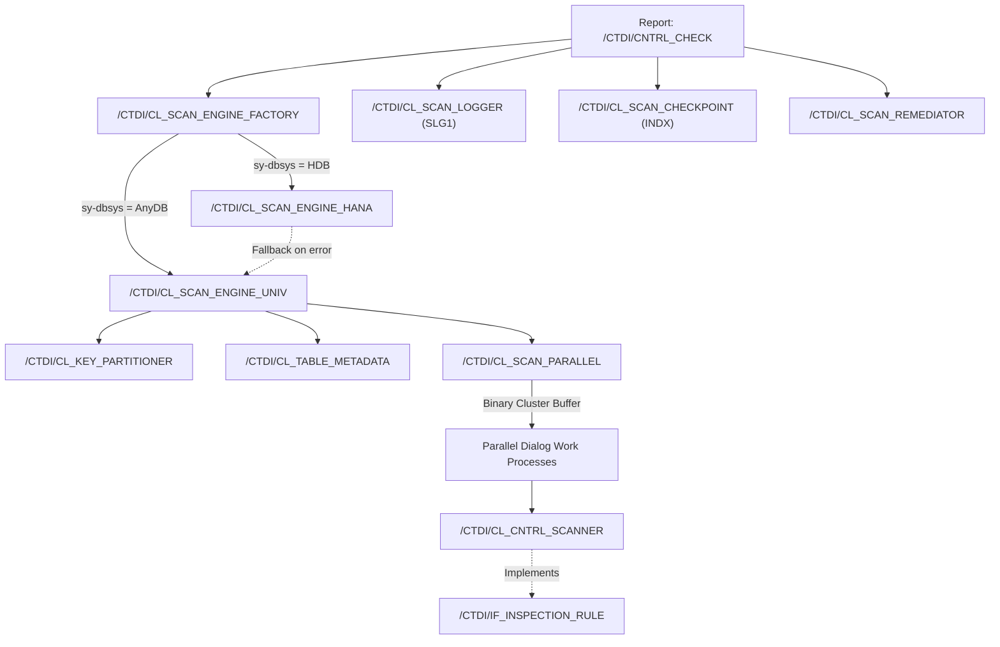

# /CTDI/ Enterprise Utilities (`bs_util`)

High-performance, fault-tolerant enterprise data quality scanner and utility suite for **SAP ECC ABAP 7.50 SP14 (AnyDB)** and **SAP S/4HANA**.

Designed to scan, detect, and remediate illegal control characters, non-printable code points, and data defects across multi-million row tables with bounded memory, parallel work process distribution, and zero-downtime database portability.

---

## 📑 Architecture & Technical Documentation

| Document | Description |
| :--- | :--- |
| 📄 **[Changelog & Architecture Upgrade](SCANNER_ARCHITECTURE_CHANGES.md)** | Full modernization history, phased architectural enhancements, and Clean Core upgrades. |
| 🛡️ **[Governed Remediation & Review Console](SCANNER_REVIEW_REMEDIATION.md)** | Persistent worklist table `/CTDI/SCAN_HITS`, read-only scanner decoupling, and `/CTDI/CNTRL_REVIEW`. |
| 🔍 **[Verified Review Findings & Audit](SCANNER_REVIEW_FINDINGS.md)** | Line-by-line architectural, functional, and performance audit findings and benchmarks. |
| 📊 **[Architecture & UML Diagrams](SCANNER_DIAGRAMS.md)** | Validated UML Class, Sequence, Activity, Component, and State Machine diagrams. |
| 🔄 **[Checkpoint & Resume Specification](RESUME_SCENARIO.md)** | Deep-dive into cluster table `INDX` state persistence, key boundaries, and fault resumption. |

---

## 🏛️ High-Level Architecture

The suite adopts the **Strategy Pattern** and **Dynamic Factory Resolution** to maintain a unified codebase that operates across AnyDB (Oracle, DB2, MSSQL) today and enables in-memory SAP HANA column store pushdown without code modification.

---

## ✨ Key Enterprise Capabilities

### 1. High-Throughput Concurrency & Clean Core IPC
- **Clean Core Process Counting**: Eliminates unreleased kernel calls (`CALL 'ThWpInfo'`), adopting standard `SPBT_GET_PP_INFO` (for RFC Server Groups via `RZ12`) and `TH_WP_INFO` (for dialog process availability).
- **Binary Cluster Serialization**: Replaces fragile XML 1.0 IPC with native ABAP binary buffers (`EXPORT ... TO DATA BUFFER`). Binary-safe (preserves `0x00` NUL bytes), 3–4x faster, and uses 65% less memory in transit.

### 2. Zero-Branching Database Portability
- **Strategy Pattern Engine**: Factory dynamically resolves [`/CTDI/CL_SCAN_ENGINE_HANA`](src/%23ctdi%23cl_scan_engine_hana.clas.abap) on SAP HANA and [`/CTDI/CL_SCAN_ENGINE_UNIV`](src/%23ctdi%23cl_scan_engine_univ.clas.abap) on AnyDB.
- **Pushdown with Safe Fallback**: In-memory regex/pattern filtering on HANA falls back to universal slicing if unsupported rules are encountered.

### 3. Fault-Tolerant Checkpointing (`INDX`)
- **State Persistence**: Checkpoints (`run_id`, `tabname`, `last_end_key`, `rows_scanned`, `status`) are saved in cluster table `INDX` (Area `SC`).
- **Resumption (`p_res = 'X'`)**: If a run times out or is cancelled, re-executing with resume generates a strictly-greater-than WHERE condition from `last_end_key`, bypassing already-scanned rows with zero duplicate I/O.

### 4. Enterprise Observability & Audit Logging
- **SAP Application Log (`SLG1`)**: Runs are tracked under Object `/CTDI/SCAN`, Subobject `RUN` via [`/CTDI/CL_SCAN_LOGGER`](src/%23ctdi%23cl_scan_logger.clas.abap).
- **Batch Integration**: When executed via background job (`SM37`), automatically streams informational milestones to the spool/job log.

### 5. Governed Data Remediation
- **Simulation Mode (`p_rsim`)**: Generates before/after cleansed field matrices without database modifications and renders them in a dedicated SALV grid.
- **Governed Live Updates (`p_rfix`)**: Prompts user confirmation via `POPUP_TO_CONFIRM`, acquires SAP table enqueue locks (`ENQUEUE_E_TABLE`), updates data, commits work, and releases locks (`DEQUEUE_E_TABLE`).

---

## 📦 Object Inventory

### Orchestration & Presentation
- [`/CTDI/CNTRL_CHECK`](src/%23ctdi%23cntrl_check.prog.abap) (Report): Main orchestration driver, selection screen, and SALV results presenter.
- [`/CTDI/CNTRL_CHECK_V2`](src/%23ctdi%23cntrl_check_v2.prog.abap) (Report): Modernized 4-zone selection screen variant with ergonomic UX layout.
- [`/CTDI/CNTRL_CHECK.PROG.XML`](src/%23ctdi%23cntrl_check.prog.xml): Text pool, parameter texts, and abapGit DDIC metadata.

### Core Architecture & Strategy Pattern
- [`/CTDI/IF_SCAN_ENGINE`](src/%23ctdi%23if_scan_engine.intf.abap): Common engine contract for table inspection.
- [`/CTDI/CL_SCAN_ENGINE_FACTORY`](src/%23ctdi%23cl_scan_engine_factory.clas.abap): Runtime strategy resolver based on `sy-dbsys`.
- [`/CTDI/CL_SCAN_ENGINE_UNIV`](src/%23ctdi%23cl_scan_engine_univ.clas.abap): Universal parallel slicing engine for AnyDB and HANA.
- [`/CTDI/CL_SCAN_ENGINE_HANA`](src/%23ctdi%23cl_scan_engine_hana.clas.abap): In-memory column store pushdown engine with automatic fallback.

### Inspection & Rule Engine
- [`/CTDI/IF_INSPECTION_RULE`](src/%23ctdi%23if_inspection_rule.intf.abap): Pluggable rule interface for data quality inspection.
- [`/CTDI/CL_CNTRL_SCANNER`](src/%23ctdi%23cl_cntrl_scanner.clas.abap): Fast-path C-kernel `NA`/`CA` scanner for control characters (C0, DEL, C1, NBSP, zero-width spaces).

### Partitioning & Data Access
- [`/CTDI/CL_TABLE_METADATA`](src/%23ctdi%23cl_table_metadata.clas.abap): RTTI analyzer for character columns, primary keys, check-tables, and authorizations.
- [`/CTDI/CL_KEY_PARTITIONER`](src/%23ctdi%23cl_key_partitioner.clas.abap): Keys-only probe slicer and dynamic lexicographic WHERE builder.
- [`/CTDI/CL_TABLE_READER`](src/%23ctdi%23cl_table_reader.clas.abap): Facade combining metadata and partitioner for backward-compatible block, stream, and RFC reads.
- [`/CTDI/CL_SCAN_PARALLEL`](src/%23ctdi%23cl_scan_parallel.clas.abap): Parallel coordinator driving asynchronous RFC tasks via binary data buffers.

### Governance, Resilience & Remediation
- [`/CTDI/CL_SCAN_LOGGER`](src/%23ctdi%23cl_scan_logger.clas.abap): SAP Application Log (`SLG1`) and SM37 batch log manager.
- [`/CTDI/CL_SCAN_CHECKPOINT`](src/%23ctdi%23cl_scan_checkpoint.clas.abap): Persistent checkpoint manager backed by cluster table `INDX`.
- [`/CTDI/CL_SCAN_REMEDIATOR`](src/%23ctdi%23cl_scan_remediator.clas.abap): Simulation diff builder and governed table updater.

### Additional Repository Utilities
- [`/CTDI/YFIND_USEREXIT`](src/%23ctdi%23yfind_userexit.prog.abap) (Report): User exit, customer exit, and enhancement search utility.
- [`/CTDI/ZTUTYP_UPD`](src/%23ctdi%23ztutyp_upd.prog.abap) (Report): Packaging type / TU type mass update utility.
- [`/CTDI/BS_UTIL`](src/%23ctdi%23bs_util.fugr.remove_idoc.abap) (Function Group): Business system utilities (including `REMOVE_IDOC`).
- [`/CTDI/SD01`](src/%23ctdi%23sd01.fugr.%23ctdi%23va02_goodpartreturn02.abap) (Function Group): Sales & Distribution utility functions.

---

## 🚀 Usage Guide: Running `/CTDI/CNTRL_CHECK`

### Selection Screen Parameters

| Parameter | Type | Default | Description |
| :--- | :--- | :---: | :--- |
| `P_TAB` | Parameter | *Required* | Table name to scan (e.g. `VTRKH`, `KNA1`, `VBAK`). |
| `P_MFST` | Radiobutton | `X` | Read first block (up to `P_MAX` rows). |
| `P_MLST` | Radiobutton | ` ` | Read last block by primary key. |
| `P_MFUL` | Radiobutton | ` ` | Full table scan (streaming mode). |
| `P_PAR` | Checkbox | ` ` | Enable parallel dialog work process scanning. |
| `P_PCT` | Parameter | `50` | % of free dialog work processes to utilize. |
| `P_GRP` | Parameter | `parallel_generators` | RFC Server Group (F4 help from `RZ12`). |
| `P_AUTO` | Checkbox | `X` | Adaptive package sizing (clamps to sweet-spot 40k–60k band). |
| `P_LOG` | Checkbox | `X` | Record run to SAP Application Log (`SLG1`) & batch log. |
| `P_RES` | Checkbox | ` ` | Resume interrupted run from last checkpoint on `INDX`. |
| `P_RSCAN` | Radiobutton | `X` | **Scan Only**: Display findings in SALV grid. |
| `P_RSIM` | Radiobutton | ` ` | **Simulate Remediation**: Display before/after cleaned values diff grid. |
| `P_RFIX` | Radiobutton | ` ` | **Apply Remediation**: Governed live update with enqueue locking. |
| `P_RCHR` | Parameter | `' '` | Replacement character (default space). |

---

## 🧪 Quality Assurance & Test Coverage

The codebase undergoes automated testing and static analysis:
- **`abaplint` Verified**: Zero syntax errors and zero parser errors across all objects.
- **68 Unit Tests**: 100% definition-to-implementation parity across 13 ABAP unit test classes covering IPC binary roundtrips, adaptive sizing boundaries, composite key partitioning, fallback resolution, and remediation diff calculation.

---

## 📥 Installation via abapGit

1. Ensure [abapGit](https://abapgit.org) is installed in your SAP system.
2. Link this Git repository to package namespace `/CTDI/`.
3. Pull all objects and activate them in the SAP Data Dictionary (DDIC).
4. Run report `/CTDI/CNTRL_CHECK` via transaction `SE38` or `SA38`.
