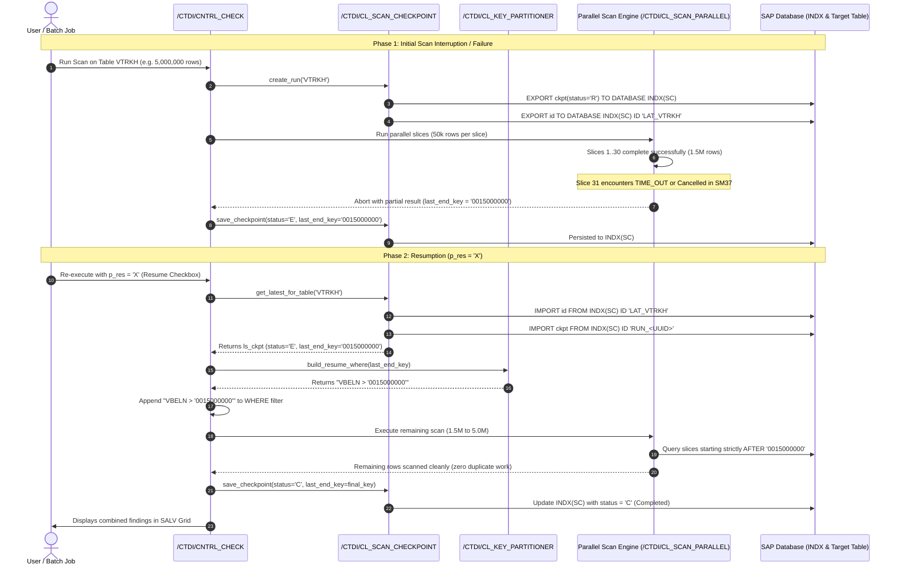
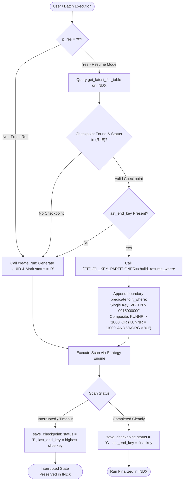

# Checkpoint & Resume Scenario Specification

This document details the mechanics, persistence architecture, and execution flow of the **Checkpoint & Resumption Workflow** implemented for the `/CTDI/` Enterprise Table Scanner.

---

## 1. Resume Lifecycle Sequence Diagram



---

## 2. Checkpoint Decision Flowchart



---

## 3. Technical Implementation Details

### 3.1 Persistent Storage Mechanism
All run states and key boundaries are stored in **SAP Cluster Table `INDX`** in relational area **`SC`** (Scan Checkpoint) via [`/CTDI/CL_SCAN_CHECKPOINT`](file:///d:/_Repos/bs_util/src/%23ctdi%23cl_scan_checkpoint.clas.abap):
- **Checkpoint Data**: Exported with ID `RUN_<UUID>`:
  ```abap
  EXPORT ckpt = is_checkpoint TO DATABASE indx(sc) ID lv_id.
  ```
- **Table Index Pointer**: Exported with ID `LAT_<TABNAME>` (e.g. `LAT_VTRKH`) to point to the latest run ID:
  ```abap
  EXPORT id = rv_run_id TO DATABASE indx(sc) ID lv_lat_id.
  ```

### 3.2 State Structure (`ts_checkpoint`)
```abap
TYPES:
  BEGIN OF ts_checkpoint,
    run_id       TYPE sysuuid_c32,                          " 32-character UUID
    tabname      TYPE tabname,                              " Target table name
    last_end_key TYPE /ctdi/cl_key_partitioner=>tt_keyval,  " Last processed key boundary
    rows_scanned TYPE i,                                    " Total rows processed so far
    hits_count   TYPE i,                                    " Violations accumulated so far
    status       TYPE c LENGTH 1,                           " 'R'=Running, 'C'=Completed, 'E'=Error
    tstamp       TYPE timestamp,                            " Last state timestamp
  END OF ts_checkpoint.
```

### 3.3 Dynamic SQL WHERE Clause Construction
When resuming, [`/CTDI/CL_KEY_PARTITIONER=>build_resume_where`](file:///d:/_Repos/bs_util/src/%23ctdi%23cl_key_partitioner.clas.abap) generates an Open SQL lexicographic boundary filter:
- **Single Key Field**:
  ```sql
  VBELN > '0015000000'
  ```
- **Multi-Field Composite Primary Key** (`KUNNR`, `VKORG`, `VTWEG`):
  ```sql
  ( KUNNR > '0000100000' OR 
    ( KUNNR = '0000100000' AND VKORG > '1000' ) OR 
    ( KUNNR = '0000100000' AND VKORG = '1000' AND VTWEG > '10' ) )
  ```

### 3.4 Zero Duplicate I/O Guarantee
Because the generated resume condition is passed into `lo_engine->execute( ... where = lt_where )`:
1. `probe_slices` runs keys-only probes on `WHERE (resume_predicate)`.
2. The database B-Tree / column-store primary key index immediately jumps past all already-processed rows.
3. Worker tasks only fetch and scan uninspected records.
