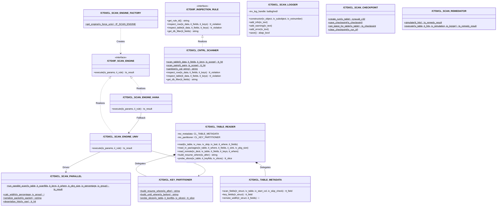
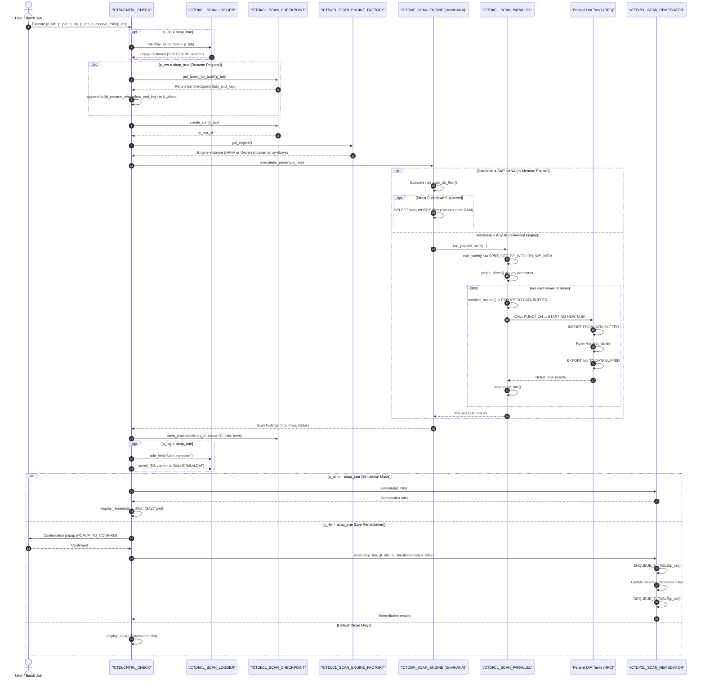
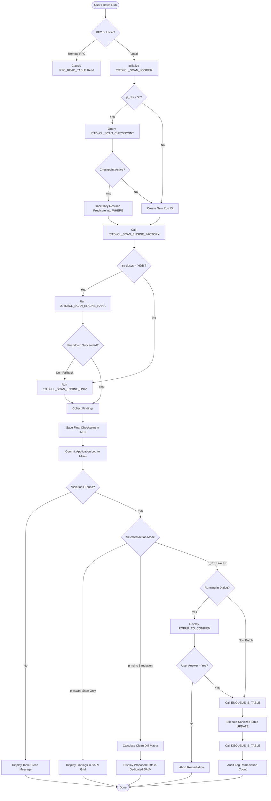
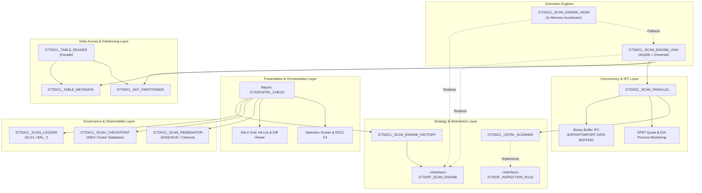
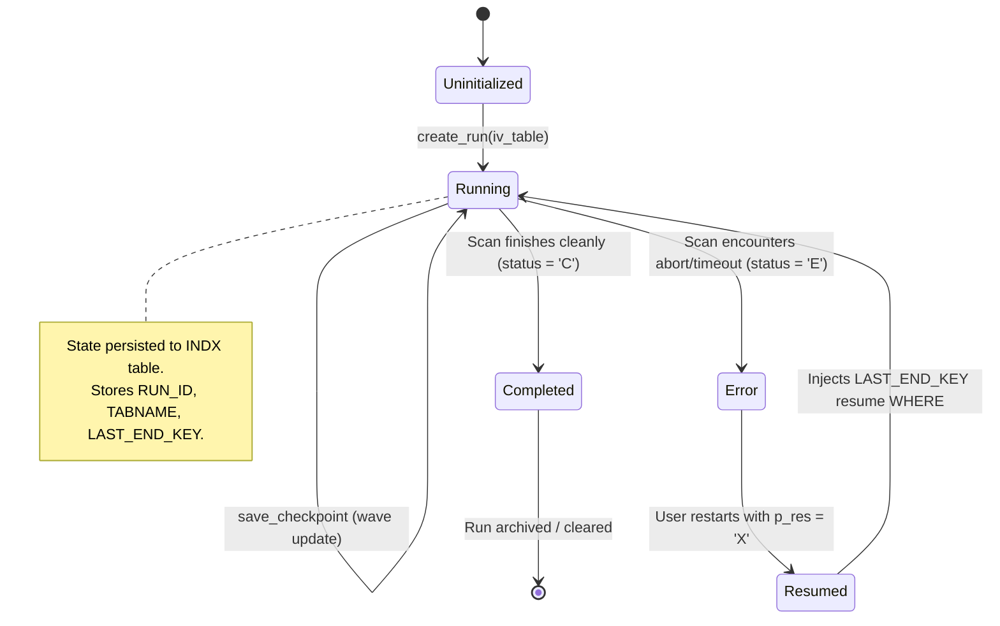

# Enterprise Table Scanner - Architecture & UML Diagrams

This document contains the complete UML diagram specifications for the `/CTDI/` Table Scanner Architecture Modernization in `bs_util`.

---

## 1. UML Class Diagram (Domain Model & Design Patterns)

The architecture leverages the **Strategy Pattern** for database adaptability, the **Factory Pattern** for engine resolution, and **Separation of Concerns** across data inspection, partitioning, and governance.

---

## 2. UML Sequence Diagram: End-to-End Execution Flow

This diagram illustrates the lifecycle of a scan request initiated by a user or background job through `/CTDI/CNTRL_CHECK`.

---

## 3. UML Activity Diagram: Observability, Checkpointing & Remediation Workflow

---

## 4. UML Component & Layered Architecture Diagram

---

## 5. Checkpoint State Machine Diagram

