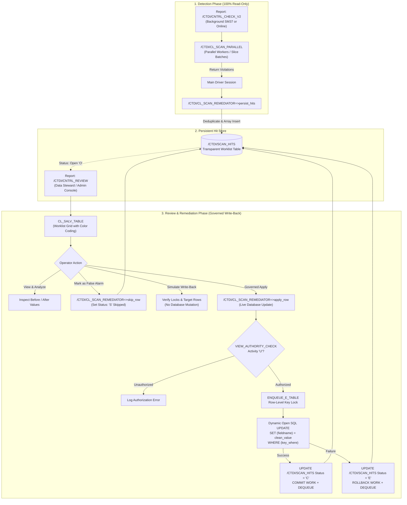

# Enterprise Scanner Review & Governed Remediation Architecture

## 1. Executive Summary & Design Rationale

This document specifies the architectural decoupling of **defect detection** from **data remediation** within the `/CTDI/` Enterprise Scanner Suite (`bs_util`).

### The Architectural Problem
In the initial scanner prototype:
1. **Destructive write risk during batch scanning**: Selection parameter `p_rfix` ("Apply") was part of the main scanner report (`/CTDI/CNTRL_CHECK` / `_V2`). Running a full-table background scan (`SM37`) with live write-back posed severe risks of unintended mass updates and long-running table locks.
2. **Locking & multi-hit gaps (Audit Finding 2.4)**: `CL_SCAN_REMEDIATOR` was a stub holding an `ENQUEUE_E_TABLE` lock across the entire table without performing SQL updates, and multiple control characters in a single field produced duplicate diff entries.
3. **No persistent worklist**: Findings were transient in memory or ALV lists. Data stewards could not review findings asynchronously, approve a subset, or audit what was modified and by whom.

### The Decoupled Solution
The suite now strictly enforces **Separation of Concerns (SoC)** and the **Four-Eyes Principle**:
* **Scanners are 100% Read-Only**: [`/CTDI/CNTRL_CHECK`](src/%23ctdi%23cntrl_check.prog.abap) and [`/CTDI/CNTRL_CHECK_V2`](src/%23ctdi%23cntrl_check_v2.prog.abap) only inspect and report. They cannot mutate business tables.
* **Persistent Worklist Store**: Scanners automatically persist deduplicated findings to a transparent database table, [`/CTDI/SCAN_HITS`](src/%23ctdi%23scan_hits.tabl.xml), tagged with a unique `RUN_ID`.
* **Dedicated Governance Console**: A separate review transaction/report, [`/CTDI/CNTRL_REVIEW`](src/%23ctdi%23cntrl_review.prog.abap), loads stored findings into an interactive ALV grid for visual inspection, simulation, and governed, transactional write-back.

---

## 2. End-to-End Architecture & Data Flow



---

## 3. Persistent Worklist Table: `/CTDI/SCAN_HITS`

Implemented in [`src/#ctdi#scan_hits.tabl.xml`](src/%23ctdi%23scan_hits.tabl.xml) as an enterprise transparent table with primary key `(MANDT, RUN_ID, ITEM_NO)`.

### Field Specifications

| Field Name | Key | Data Element / Type | Description |
| :--- | :---: | :--- | :--- |
| `MANDT` | **X** | `MANDT` (CLNT 3) | Client |
| `RUN_ID` | **X** | `SYSUUID_C22` (CHAR 22) | Unique run UUID generated by `CL_SYSTEM_UUID` |
| `ITEM_NO` | **X** | `INT4` | 1-based sequential finding index within the run |
| `TABNAME` | | `TABNAME` (CHAR 30) | Scanned database table name |
| `KEYINFO` | | `TEXT255` (CHAR 255) | Human-readable key representation (e.g. `VBELN=0000001000 POSNR=000010`) |
| `KEY_WHERE` | | `STRING` | Pre-formatted SQL `WHERE` expression for row-level update (zero truncation risk) |
| `FIELDNAME` | | `FIELDNAME` (CHAR 30) | Column containing the invalid character |
| `CODEPOINT` | | `CHAR4` (CHAR 4) | Hexadecimal representation of first detected defect (e.g. `000A`) |
| `HIT_COUNT` | | `INT4` | Total defect occurrences within this field value |
| `ORIG_VALUE` | | `STRING` | Original raw content read from the database |
| `CLEAN_VALUE`| | `STRING` | Proposed cleansed value generated by `sanitize` |
| `STATUS` | | `CHAR1` (CHAR 1) | Lifecycle status (`O` Open, `C` Cleaned, `S` Skipped, `E` Error) |
| `MESSAGE` | | `BAPI_MSG` (CHAR 220) | Execution log or SQL error message |
| `SCAN_USER` | | `UNAME` (CHAR 12) | User who executed the detection scan |
| `SCAN_TSTMP` | | `TIMESTAMP` (DEC 15) | UTC timestamp of scan execution |
| `APPLY_USER` | | `UNAME` (CHAR 12) | User who executed the remediation |
| `APPLY_TSTMP`| | `TIMESTAMP` (DEC 15) | UTC timestamp of remediation |

### Lifecycle Status Matrix

```
       [ Scan Run ]
            │
            ▼
        ┌───────┐
        │ Open  │ (Status 'O')
        └───┬───┘
            │
    ┌───────┼───────┐
    │       │       │
    ▼       ▼       ▼
┌───────┐┌───────┐┌───────┐
│Cleaned││Skipped││ Error │
│  'C'  ││  'S'  ││  'E'  │
└───────┘└───────┘└───┬───┘
                      │ (Retry after fix)
                      └────────┘
```

---

## 4. Remediation Engine: `/CTDI/CL_SCAN_REMEDIATOR`

Implemented in [`src/#ctdi#cl_scan_remediator.clas.abap`](src/%23ctdi%23cl_scan_remediator.clas.abap).

### Core Methods & Implementation Details

#### 1. `persist_hits`
* **Multi-Hit Deduplication**: Aggregates raw scanner hit packets by `(KEYINFO, FIELD)`. If a field contains multiple carriage returns, line feeds, and tabs, only **one** record is generated for the worklist with `hit_count` reflecting the total defects.
* **SQL WHERE Clause Compilation**: Calls `parse_keyinfo_to_where` to convert `KEYINFO` pairs (`VBELN=1000 POSNR=10`) into SQL expressions (`VBELN = '1000' AND POSNR = '10'`).
* **Array Insertion**: Uses `INSERT /ctdi/scan_hits FROM TABLE @lt_records ACCEPTING DUPLICATE KEYS` for fast bulk staging.

#### 2. `apply_row` (Transactional Write-Back)
* **Pre-Flight Authorization**:
  ```abap
  CALL FUNCTION 'VIEW_AUTHORITY_CHECK'
    EXPORTING
      view_action                    = 'U'
      view_name                      = is_hit-tabname
    EXCEPTIONS
      no_authority                   = 1
      no_clientindependent_authority = 2
      OTHERS                         = 3.
  ```
* **Simulation Path**:
  When `iv_simulation = abap_true`, tests row accessibility and dynamic SQL compilation without modifying data:
  ```abap
  SELECT COUNT(*) FROM (is_hit-tabname) INTO @lv_count WHERE (is_hit-key_where).
  ```
* **Row-Level Enqueue Locking**:
  Uses SAP generic table lock `ENQUEUE_E_TABLE` with `varkey = is_hit-keyinfo` to protect only the affected record, leaving the rest of the table unlocked:
  ```abap
  CALL FUNCTION 'ENQUEUE_E_TABLE'
    EXPORTING
      tabname        = is_hit-tabname
      varkey         = is_hit-keyinfo
    EXCEPTIONS
      foreign_lock   = 1
      system_failure = 2
      OTHERS         = 3.
  ```
* **Client Isolation Guard**:
  Rejects cross-client executions if `is_hit-mandt` does not match the active session client (`sy-mandt`).
* **Dynamic Open SQL Execution with Multi-Row Guard (`sy-dbcnt = 1`)**:
  Quotes cleaned values via `/ctdi/cl_key_partitioner=>quote_literal`, executes dynamic update, and enforces that exactly **one** row was affected:
  ```abap
  DATA(lv_quoted_val) = /ctdi/cl_key_partitioner=>quote_literal( is_hit-clean_value ).
  DATA(lv_set_clause) = |{ is_hit-fieldname } = { lv_quoted_val }|.

  UPDATE (is_hit-tabname)
    SET (lv_set_clause)
    WHERE (is_hit-key_where).

  IF sy-subrc = 0.
    IF sy-dbcnt = 1.
      " Safe: exactly one target record was updated
      COMMIT WORK.
      ...
    ELSE.
      " CRITICAL: Multi-row mutation detected! Rollback immediately
      ROLLBACK WORK.
      rs_result-message = |Safety abort: WHERE matched { sy-dbcnt } rows instead of 1! Rolled back.|.
    ENDIF.
  ENDIF.
  ```
* **Worklist Status Update**:
  * On success: Updates `/CTDI/SCAN_HITS` with `status = 'C'`, stamps `apply_user = sy-uname` and timestamp, then issues `COMMIT WORK`.
  * On failure: Issues `ROLLBACK WORK`, logs the exception text in `/CTDI/SCAN_HITS-MESSAGE`, and updates `status = 'E'`.
  * Releases lock via `DEQUEUE_E_TABLE`.

#### 3. `skip_row`
Marks false positives or intentional whitespace records with `status = 'S'`, auditing the decision with `apply_user` and timestamp.

---

## 5. Review & Remediation Console: `/CTDI/CNTRL_REVIEW`

Implemented in [`src/#ctdi#cntrl_review.prog.abap`](src/%23ctdi%23cntrl_review.prog.abap) and [`src/#ctdi#cntrl_review.prog.xml`](src/%23ctdi%23cntrl_review.prog.xml).

### Selection Screen Features

1. **Scan Run ID (`P_RUNID`) with Dynamic F4 Help**:
   Queries `/CTDI/SCAN_HITS` to display recent runs with table name, scan user, and timestamp:
   ```abap
   AT SELECTION-SCREEN ON VALUE-REQUEST FOR p_runid.
     lcl_review_app=>f4_run_id( ).
   ```
2. **Table Name (`P_TAB`)**:
   Standard DDIC table search help (`DD_DBTB_16`).
3. **Status Filter (`SO_STAT`)**:
   Select-options defaulting to `O` (Open) to focus directly on unprocessed findings.
4. **Operation Modes**:
   * `P_MVIEW`: **Review Findings (ALV Grid)** — Read-only visual inspection using `CL_SALV_TABLE`.
   * `P_MAPPL`: **Apply Cleaned Values** — Governed write-back with safety prompt (`POPUP_TO_CONFIRM`).
   * `P_MSKIP`: **Mark as Skipped** — Batch transition to status `'S'`.
   * `P_SIMUL`: **Simulation Run** — Test run toggle (disabled when not in apply mode).

---

## 6. Scanner Integration & Read-Only Decoupling

Both detection programs have been modified to enforce read-only execution:
* [`/CTDI/CNTRL_CHECK_V2`](src/%23ctdi%23cntrl_check_v2.prog.abap)
* [`/CTDI/CNTRL_CHECK`](src/%23ctdi%23cntrl_check.prog.abap)

### Key Changes
1. **Removed `P_RFIX`**: Removed the direct update radiobutton from the selection screen and removed all database write logic from the scanner programs.
2. **Added `P_SAVE`**: Added parameter `P_SAVE AS CHECKBOX DEFAULT 'X'` ("Persist findings to /CTDI/SCAN_HITS worklist").
3. **Automated Staging**:
   When a scan identifies defects and `P_SAVE = 'X'`, findings are persisted into `/CTDI/SCAN_HITS` and the user is notified with the generated Run ID:
   ```
   N findings saved to worklist /CTDI/SCAN_HITS (Run ID: ...). Review & apply in /CTDI/CNTRL_REVIEW
   ```
4. **Replacement Character Support (`P_RCHR`)**:
   Updated [`/CTDI/CL_CNTRL_SCANNER=>sanitize`](src/%23ctdi%23cl_cntrl_scanner.clas.abap#L139-L143) to accept `iv_rep_char TYPE clike DEFAULT ` ``, allowing callers to customize the replacement character for collapsed whitespace controls.

---

## 7. Operational Playbook & Best Practices

### Workflow Step 1: Automated / Overnight Scan
* Schedule [`/CTDI/CNTRL_CHECK_V2`](src/%23ctdi%23cntrl_check_v2.prog.abap) in `SM37` across target tables.
* Keep `P_SAVE = 'X'` and `P_PAR = 'X'`.
* Scanners run safely at scale without taking table locks or updating rows.

### Workflow Step 2: Data Steward Review
* Launch `/CTDI/CNTRL_REVIEW`.
* Use F4 on `P_RUNID` to select the overnight run.
* Run in **Review Mode (`P_MVIEW`)** to examine findings in ALV, comparing original values with cleaned proposals.

### Workflow Step 3: Simulation
* Switch mode to **Apply Cleaned Values (`P_MAPPL`)** with **Simulation (`P_SIMUL = 'X'`)**.
* Verify that target records still exist and can be locked without conflict.

### Workflow Step 4: Governed Write-Back
* Uncheck **Simulation (`P_SIMUL = ' '`)**.
* Confirm the dialog popup.
* The system executes row-level enqueues, dynamic SQL updates, audit logging, and marks worklist items as `'C'`.
* Review the final execution ALV report showing individual item outcomes.

---

## 8. Technical Limits, Edge Cases & Applied Safety Guards

When executing generic dynamic Open SQL (`UPDATE (tabname) SET (set_clause) WHERE (key_where)`), standard application BAPIs and business validations are bypassed. The framework applies concrete safeguards to address these limits:

| Risk / Limit Area | Technical Constraint | Framework Safeguard |
| :--- | :--- | :--- |
| **Multi-Row Mutation** | Ambiguous or incomplete WHERE clause mutating multiple rows | **`sy-dbcnt = 1` Guard**: Evaluates `sy-dbcnt` immediately post-update. If `sy-dbcnt > 1`, issues immediate `ROLLBACK WORK` and sets status `'E'`. |
| **Client Separation** | Reviewer executing across different clients (`MANDT`) | **Client Guard**: Verifies `is_hit-mandt = sy-mandt` before lock acquisition or update; blocks cross-client tampering. |
| **WHERE Clause Truncation** | Tables with wide composite keys (e.g. 5–8 key fields) | **Dynamic `STRING` Storage**: `KEY_WHERE` in `/CTDI/SCAN_HITS` is defined as `STRING` instead of `CHAR 255`, preventing clause truncation. |
| **SQL Injection & Escaping** | Values containing quotes (`'`) breaking dynamic syntax | **C-Kernel Quoting**: All literals pass through `/ctdi/cl_key_partitioner=>quote_literal`, converting `'` to `''`. |
| **Lock Object Disparity** | `ENQUEUE_E_TABLE` does not block business locks (e.g. `EVVBLKE`) | **Row-Level Generic Lock + Maintenance Window Recommendation**: Locks `varkey = keyinfo` to minimize lock footprint; recommends applying during quiet periods. |
| **SAP Table Buffering** | Tables with shared memory buffering (`BUFALLOW = 'X'`) | Local buffer invalidated automatically; operator documentation notes cross-server buffer synchronization lag (`rdisp/bufreftime`). |
| **Audit Compliance** | Direct Open SQL does not generate `CDHDR` / `CDPOS` logs | **Persistent Audit Staging**: `/CTDI/SCAN_HITS` serves as the dedicated audit log, preserving original value, cleaned value, user, and timestamps. |
| **Domain Constraints** | Direct write bypassing `NUMC` leading zeroes or `UPPERCASE` flags | **Pre-Validated Sanitizer**: `sanitize` only cleans non-printable control code points, preserving alphanumeric domain values and case formatting. |

